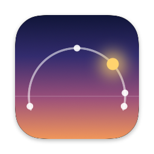
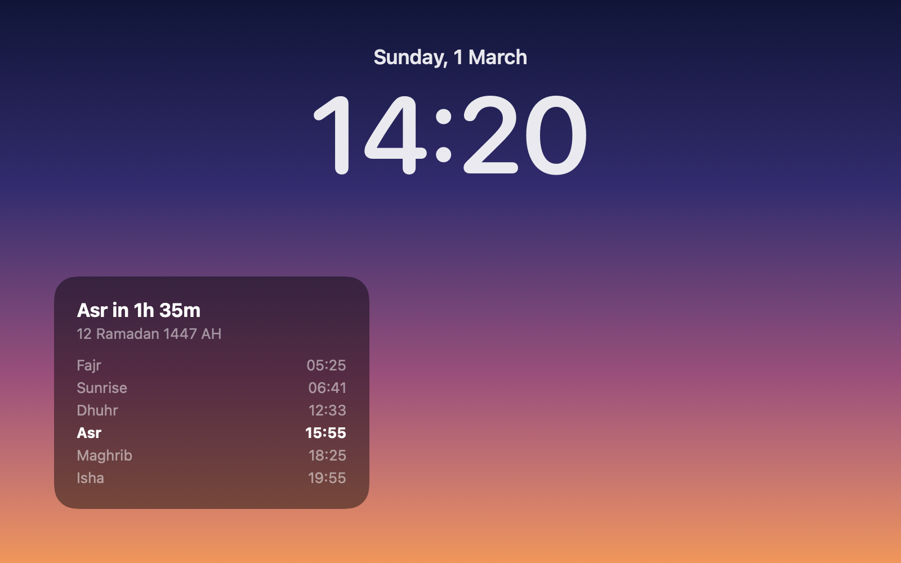

<div align="center">



# iMiqaat

**Salah times on your Mac's Lock Screen.**

[](https://github.com/u-sm/imiqaat/actions/workflows/ci.yml)
[](LICENSE)
[](#requirements)
[](https://swift.org)
[](docs/ROADMAP.md)
[](CONTRIBUTING.md)

</div>

---

> [!WARNING]
> iMiqaat is in early development. Pre-releases are available for testing; follow the [roadmap](docs/ROADMAP.md) to see what is being built.

## Features




<sub>Rendered from the app's own views with sample data for Makkah. The wallpaper is a stand-in.</sub>

- 🕌 **The next prayer**, with a live countdown, right on the Lock Screen.
- 📅 **Today's times**: Fajr, Sunrise, Dhuhr, Asr, Maghrib and Isha.
- 🌙 **The Hijri date**, from the Umm al-Qura calendar.
- 🧭 **Your choice of calculation method, Asr madhab and high-latitude rule.**
- 📴 **Works offline.** Times are calculated on your Mac, and iMiqaat never sends your location anywhere.
- 🎛️ **Lives in the menu bar**, with no Dock icon, and can start at login.

Coming next: iqamah times, reminders and the adhan, widget styles, Ramadan mode and Arabic. See the [roadmap](docs/ROADMAP.md).

## How it works

macOS has no public API for drawing on the Lock Screen. iMiqaat places its window in a private WindowServer Space above the lock layer, using a technique adapted from [SkyLightWindow](https://github.com/Lakr233/SkyLightWindow). Prayer times are calculated locally with [adhan-swift](https://github.com/batoulapps/adhan-swift).

> [!IMPORTANT]
> Because iMiqaat relies on private macOS APIs:
> - It cannot be distributed through the Mac App Store. It ships as a signed, notarized download.
> - A macOS update could break the Lock Screen widget. If that happens, the menu-bar times keep working.

## Requirements

- macOS 13 or later (developed on macOS 27; older versions are untested)
- Swift 6 from the Command Line Tools or Xcode, to build from source

## Building from source

```sh
git clone https://github.com/u-sm/imiqaat.git
cd imiqaat
scripts/bundle.sh && open .build/iMiqaat.app
```

The app asks for your location once, to calculate prayer times. The location stays on your Mac.

## Installation

Download the DMG from the latest release on the [Releases](https://github.com/u-sm/imiqaat/releases) page.

Pre-releases are ad-hoc signed and not notarized by Apple, so macOS stops the app the first time you open it:

1. Open the DMG and drag **iMiqaat** to **Applications**.
2. Open iMiqaat. When macOS says it can't verify the developer, click **Done**.
3. Open **System Settings › Privacy & Security**, scroll down and click **Open Anyway** next to iMiqaat.

Notarized releases, which open without these steps, are planned for v1.0.

## Roadmap

See [docs/ROADMAP.md](docs/ROADMAP.md) for the plan and milestones.

## Contributing

Contributions are welcome. Read [CONTRIBUTING.md](CONTRIBUTING.md) for the workflow and commit conventions. This project follows the [Contributor Covenant](CODE_OF_CONDUCT.md).

To report a security issue, follow [SECURITY.md](SECURITY.md) and do not open a public issue.

## Acknowledgements

- [SkyLightWindow](https://github.com/Lakr233/SkyLightWindow) by Lakr Aream (MIT), for the Lock Screen window technique, adapted in `Sources/iMiqaat/SkyLight.swift`.
- [adhan-swift](https://github.com/batoulapps/adhan-swift) by Batoul Apps (MIT), for prayer-time calculation.

## License

iMiqaat is released under the [MIT License](LICENSE).
